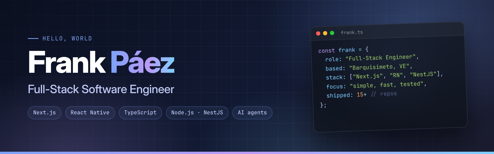

  

  

  
  
  

 

## 👋 Hey, I'm Frank

I'm a **Computer Engineer** (UCLA, Venezuela) and **full-stack developer** working in the JavaScript/TypeScript ecosystem. At **Universitas** I build platforms for the public sector: citizen participation, public procurement, credential verification, waste management, urban planning and **AI agents**.

- 🚀 Led **PDUL YA**, Iribarren's Local Urban Development Plan: from client requirements to public launch, authoring the whole frontend (citizen portal + admin panel).
- 📦 15+ repositories as author, lead developer or collaborator.
- ✅ Quality first: 500+ unit tests, E2E and accessibility suites on my latest project.
- 🎯 I care about **simplicity, clean code and smooth UX**.
- 📍 Barquisimeto, Venezuela · 🇪🇸 Spanish (native) · 🇬🇧 English (technical)

 

## 🛠️ Tech stack

<table align="center">
  <tr>
    <td align="right"><b>Languages</b></td>
    <td></td>
  </tr>
  <tr>
    <td align="right"><b>Frontend & Mobile</b></td>
    <td></td>
  </tr>
  <tr>
    <td align="right"><b>Backend</b></td>
    <td></td>
  </tr>
  <tr>
    <td align="right"><b>Cloud, AI & DevOps</b></td>
    <td></td>
  </tr>
  <tr>
    <td align="right"><b>Testing</b></td>
    <td></td>
  </tr>
</table>

  
  
  
  
  
  
  
  
  
  
  
  

 

## ✨ Highlights

| Project | What I did | Stack |
|---|---|---|
| **PDUL YA** · Local Urban Development Plan | Project lead and author of the full frontend: georeferenced citizen proposals with tracking, events, news, 3-role admin panel, metrics and audit log. Maps with automatic Google Maps → Leaflet fallback, encrypted HttpOnly sessions, CDN-cached landing. | Next.js 16 · React · TypeScript · Tailwind v4 · Zod · Vitest · Playwright · Netlify |
| **CIVIS** · Credential verification | Lead frontend of the back office (case files, configurable scoring, committee mode, ranking, legal objection workflow, audit trail) and author of the applicant portal. Backend contributions to the API. | Next.js 16 · React 19 · Radix UI · Recharts · NestJS · Fastify · Prisma 7 · PostgreSQL |
| **Public Procurement Manager** | Lead frontend: full procurement case file by phase, role-based panels, document generation and preview, compliance module, legal repository, responsive 375 → 1280 px. | Next.js · shadcn/ui · TanStack Table · Zustand · React Hook Form · Zod · Tiptap |
| **AI agents for the public sector** | Author of a procurement-compliance PoC with Analyst and Legal agents (OCR, fallback LLM provider) and contributor to RAG agents on Google ADK + Vertex AI Search. Built a multi-agent testing lab. | Python · FastAPI · Gemini · Google ADK · Laravel · Angular · Cloud Run |

 

## 📊 GitHub stats

  
  

  

 

  💬 Open to collaborating on web, mobile and AI projects · <a href="https://www.linkedin.com/in/frankpaez136"><b>Let's connect on LinkedIn</b></a>

  

